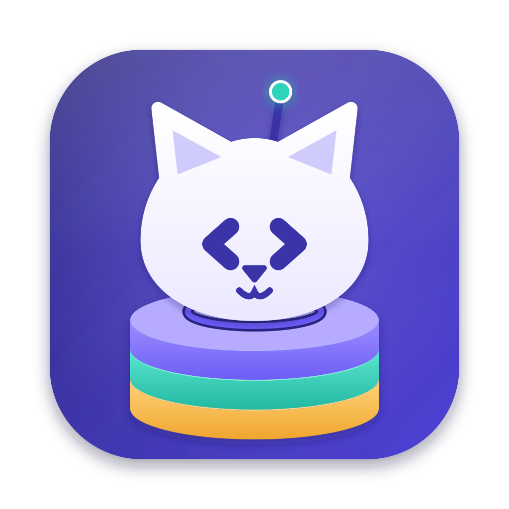

<p align="center"></p>

<h1 align="center">DevCatz</h1>
<p align="center"><em>Finally, someone herds the cats.</em></p>
<p align="center">
  <a href="https://catzoid.com/devcatz">Website</a> ·
  <a href="https://catzoid.com/devcatz/download">Download</a> ·
  <a href="https://catzoid.com/docs">Docs</a> ·
  <a href="https://catzoid.com/community">Community</a>
</p>

A local development environment for macOS. Drop a project folder in and DevCatz works out its stack, runs it, and serves every site on its own `https://<name>.localhost` with a certificate your browser trusts — next to every runtime, database, storage, search engine, mail catcher, WebSocket server, tunnel and Docker setup it needs. One app instead of a Dock full of them.

Part of [Catzoid](https://catzoid.com) — free, open-source developer tools with nine lives. All cats, no catch: no
account, no Pro tier, nothing locked behind a payment.

## What it does

- **Sites** — PHP, Node.js / Bun, Python and Go projects detected with their framework (Laravel, Next.js, Django, Gin …), each on `https://*.localhost`, monorepos and Git worktrees included.
- **Runtimes** — any PHP, Node.js, Bun, Python or Go version per site, installed for you.
- **Services** — MySQL, MariaDB, PostgreSQL, Redis, Valkey, MongoDB, Elasticsearch; S3-compatible storage; search engines; WebSocket servers; a mail catcher; gateways; tunnels to share a site.
- **Per site** — logs, `.env` editing, database links and migrations, the site’s API, Git with AI-written commit messages, Docker files generated from the stack.
- **AI, optional** — bring your own provider (Claude, OpenAI, Gemini, Ollama …); off until you switch it on.
- **The family** — databases open in [DBCatz](https://github.com/catzoidhub/DBCatz), sites become [DialCatz](https://github.com/catzoidhub/DialCatz) environments.

## Install

Download the DMG from [catzoid.com/devcatz/download](https://catzoid.com/devcatz/download) — it picks the right
build for your Mac (Apple silicon or Intel, macOS 13 or later). Or with Homebrew — it asks you to trust a tap
that is not its own the first time:

```bash
brew tap catzoidhub/catz && brew trust catzoidhub/catz
brew install --cask devcatz
```

The app is signed and notarized by Apple and updates itself (Settings → About → Check for Updates). Windows builds
are on the way.

## Build from source

```bash
bun install
bun run dev          # run it in development
bun run typecheck
bun run package      # a signed DMG in dist/ (notarized when a notarytool profile is set up)
```

Found a bug? Use **Help → Report a Bug…** in the app, or [open an issue](https://github.com/catzoidhub/DevCatz/issues).

## Licence

DevCatz is free software: you can redistribute it and/or modify it under the terms of the GNU General Public License
as published by the Free Software Foundation, version 3. It comes with no warranty. See [`LICENSE`](LICENSE).

The names Catzoid and DevCatz and the Catzoid cat are trademarks and are **not** covered by the licence: a fork must
use its own name and icon. See [`TRADEMARKS.md`](TRADEMARKS.md).

Contributions are welcome — see [`CONTRIBUTING.md`](CONTRIBUTING.md). Before your first pull request is merged you
sign the [contributor licence agreement](CLA.md) through the CLA check on the pull request — you keep the copyright of
your work. Questions and bug reports: [`SUPPORT.md`](SUPPORT.md); security problems, privately: [`SECURITY.md`](SECURITY.md).

Copyright © 2026 Mahryan Rakhmatullah
